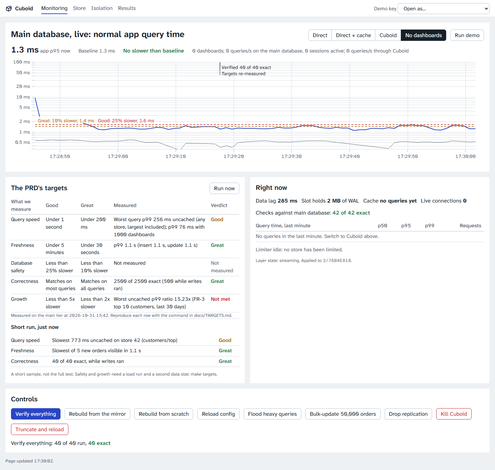
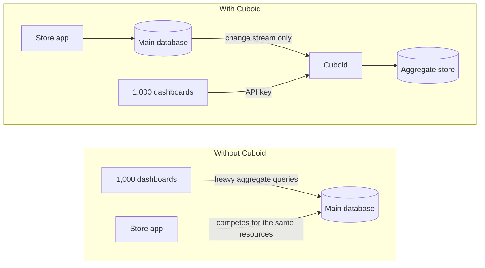

# Cuboid: Mitigata CyberForge submission

**Problem 02: fast multi-tenant data aggregation.** Live dashboards for 100 stores over 10 million orders, without overloading the database that takes those orders, and without one store ever seeing another's numbers.

| | |
|---|---|
| **Run it** | [Quick start](README.md#quick-start) |
| **The demo** | [Recording](docs/media/demo_walkthrough.webm) · [runbook with timings and fallbacks](docs/DEMO_RUNBOOK.md) · [video script](docs/DEMO_VIDEO_SCRIPT.md) |
| **The pitch** | [Deck outline](docs/DECK_OUTLINE.md) · [15 hard questions](docs/PITCH_QA.md) · [judge FAQ](docs/JUDGE_FAQ.md) |
| **The proof** | [Scorecard](docs/TARGETS.md) · [benchmarks](docs/BENCHMARKS.md) · [every PRD line traced](docs/REQUIREMENTS.md) · [raw results](artifacts/) |
| **The honest list** | [Final report: what is done, what is not](docs/FINAL_REPORT.md) |

## The problem, in the PRD's words
Dashboards need counts, trends, top-N lists and breakdowns per store. Running those on the main database means "one big store's report makes the app slow for all stores". Caching alone trades that for the failure behind INC-02, where a cache bug showed users other users' data.

## Our answer
Cuboid reads the main database's change stream and keeps exact, pre-computed rollups in a separate Postgres. Dashboards read only from there.

Three ideas carry the design:

1. **Exact, not approximate.** Updates and deletes retract the old row and add the new one. Rollup changes, mirror changes and the replication position commit in one transaction, so a crash resumes exactly.
2. **Provable.** Any number can be compared with direct SQL on the main database at the same WAL position, while writes run. This check found a real bug that unit tests could not.
3. **Separated six times over.** We inject INC-02's failure modes into our own code and count the leaks.

## What we measured
10 million orders, 100 stores, 1,000 simulated dashboards, with both databases, Cuboid, the store app and the load generator sharing one laptop (12 logical CPUs, 15.6 GB of RAM).

| PRD target | Good | Great | Measured | Verdict |
|---|---|---|---|---|
| Query speed | Under 1 s | Under 200 ms | 1,000 dashboards: p99 3 ms, 0 errors. PRD examples: under 39 ms uncached on the largest store. Top customers: 230 ms | **Good** |
| Freshness | Under 5 min | Under 30 s | p99 1.1 s | **Great** |
| Database safety | Under 25% | Under 10% | App p95 0.99 to 1.16 ms, +17.5%. Against Cuboid stopped, +28.4%. Direct: 104 ms | **Good** |
| Correctness | Most queries | All queries | 2,500 of 2,500 exact, 500 during writes | **Great** |
| Growth, 1M to 10M | Under 5x | Under 2x | 1.2x to 3.2x on the PRD's examples. Top customers: 13.7x | **Not met** |

| Attack or failure | Result, at 10M orders |
|---|---|
| 1,000,000 randomized requests, 57,153 cancelled mid-flight | 0 crossed stores |
| Leak drills A, B, C: a shared cache, a connection mix-up, a missing tenant setting | 0 leaked |
| 20 `kill -9`s under writes | Back within 3.1 s, 500 of 500 checks exact |
| 30 red-team checks: bad keys, injection, row security, recategorising, order moves | 30 of 30 pass |
| 23 acceptance checks: the PRD's examples, both rebuilds, flood, live metric, drills | 23 of 23 pass |

**The weak row.** Top customers has about 130,000 groups on the largest store, and rollups cannot shrink that. Viewers read it from cache in under 2 ms; only the uncached query is slow. The planned fix touches the exactly-once path, so we chose not to rush it.

## Every PRD line
| PRD | Status | See it |
|---|---|---|
| FR-1 Counts and totals | Done | `GET /tenants/{id}/orders/summary` |
| FR-2 Trends | Done | `GET /tenants/{id}/orders/trend?interval=day` |
| FR-3 Top-N | Done | `GET /tenants/{id}/products/top?n=10&by=sales` |
| FR-4 Breakdowns | Done | `GET /tenants/{id}/orders/breakdown?by=status` |
| FR-5 Tenant isolation | Done | Isolation page, [docs/ISOLATION.md](docs/ISOLATION.md) |
| FR-6 New data, including updates | Done | [Try it yourself](README.md#try-fr-6-yourself) |
| FR-7 API and README | Done | [README](README.md#the-endpoints), [OpenAPI](api/openapi.yaml), [Postman](api/cuboid.postman_collection.json) |
| B-1 Freshness in every response | Done | The `freshness` field |
| B-2 Rebuild from scratch | Done | Controls on `/monitor`. 0 failed queries during rebuilds at 10M |
| B-3 Heavy-query limit | Done | "Flood heavy queries". Others' p99 stayed under 3 ms |
| B-4 New metric by config | Done | Add a line to `config/metrics.yaml`: live in about a minute at 10M |
| B-5 Monitoring page | Done | `/monitor` |

## Beyond the brief
- **Run now.** The scorecard re-measures speed, freshness and correctness on the spot.
- **Same engine, Mitigata's data.** SOC alerts run through config alone: same queries, isolation and checks.
- **Company view.** An owner sees all their stores together, and each separately.
- **Autopilot.** One button drives the whole demo through the real APIs.

## The demo, in four minutes
| # | Beat | What you see |
|---|---|---|
| 1 | The problem | 1,000 dashboards query the main database, and the app's time climbs |
| 2 | Flip to Cuboid | Same load: main-database dashboard queries drop to zero |
| 3 | The PRD, live | The four examples on the largest store, each saying how fresh it is |
| 4 | New data | An order appears in about a second. Cancelled, it moves |
| 5 | Correct | A check at an exact WAL position, with arbitrary timestamps, during writes |
| 6 | Separate | Another store's key gets a 404. The drills inject INC-02: 0 leaked |
| 7 | The bonuses | A flood gets limited, and three lines of YAML add a breakdown |
| 8 | The scorecard | The weak rows, said before anyone asks |
| 9 | Close | The new breakdown, now live |

## Rules and disclosure
- **Third parties and AI.** [docs/DISCLOSURE.md](docs/DISCLOSURE.md) lists every library with its licence. Most of the code was written with Claude Code, under the team's direction, and the team can walk through it.
- **Local targets only.** The drills inject faults into Cuboid's own code, run only in demo mode, and touch nothing outside this stack.
- **Data.** Synthetic, from `cmd/seed`. The organisers' script had not arrived when this was built; [provided/README.md](provided/README.md) says how to switch.
- **Not yet run:** the Docker quick start, because Docker Desktop was broken on the build machine. Everything above was measured on the native path, with the same Postgres version, settings and ports.
