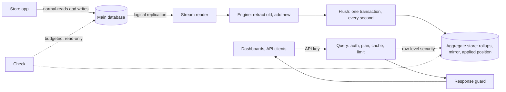
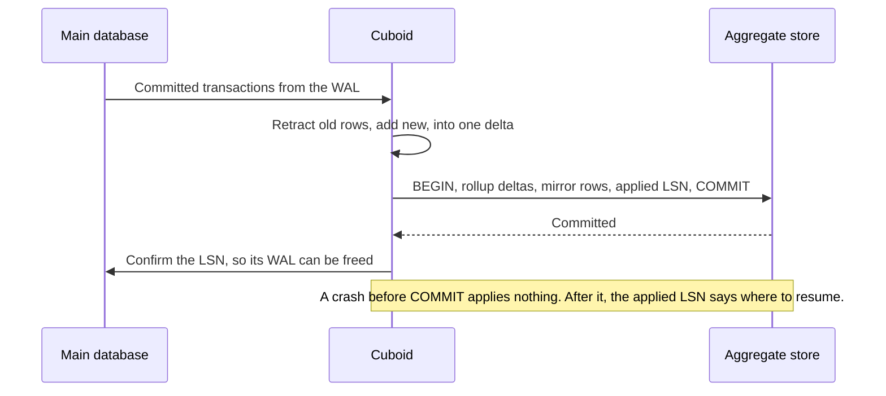
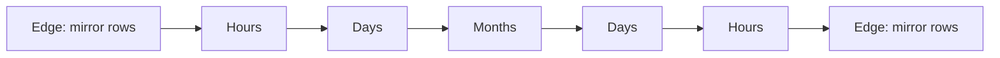
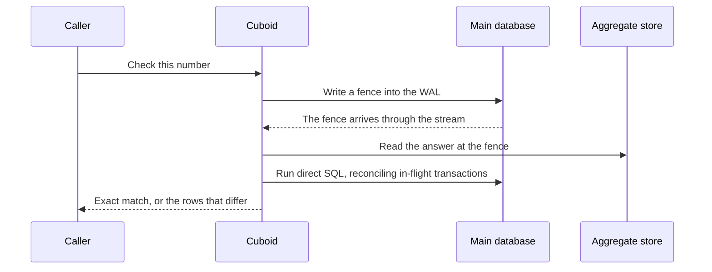
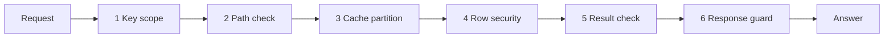

# Cuboid

**Live dashboards for every store, exact to the paisa, without touching the database that takes the orders.**

Cuboid reads the main database's change stream, keeps exact pre-computed rollups in a separate Postgres, and answers counts, trends, top-N lists and breakdowns in milliseconds for each store. Every number can be checked against the live database. Built for Mitigata CyberForge, Problem 02; the submission summary is in [HACKATHON.md](HACKATHON.md).


| At 10M orders, 100 stores, on one laptop | |
|---|---|
| 1,000 dashboards through Cuboid | **p99 3 ms**, 0 errors |
| The app's own query time under that load | **1.16 ms** at p95. Direct: 104 ms |
| New order to visible | **p99 1.1 s** |
| Numbers matching direct SQL at the same WAL position | **2,500 of 2,500** |
| Requests crossing stores, of 1,000,000 | **0** |
| `kill -9` under writes, 20 times | Back within **3.1 s**, 500 of 500 checks exact |

One query misses its targets: [top customers](#the-targets-scorecard). [The scorecard](#the-targets-scorecard) says so, and [the final report](docs/FINAL_REPORT.md) lists what was left out.

## Contents
[Quick start](#quick-start) · [Demo keys](#demo-keys) · [Endpoints](#the-endpoints) · [Try FR-6](#try-fr-6-yourself) · [Scorecard](#the-targets-scorecard) · [Bonuses](#the-bonuses) · [Screens](#screens) · [How it works](#how-it-works) · [Tests and tools](#tests-and-tools) · [More](#more)

## Quick start

With Docker:

```
docker compose up -d --build
docker compose --profile seed run --rm seed
```

Then open <http://localhost:8080/monitor>. The seed loads 1M orders across 10 stores, and Cuboid then loads a snapshot of them, which took under a minute on our laptop. For the main tier use `SEED_TIER=main`, which took about 12 minutes in total.

Settings can be changed through `.env`; see `.env.example`. The organisers' data script goes in `provided/`; see `provided/README.md`.

**Status of this path:** Docker Desktop was broken on the machine this was built on, so the Compose files have not been run yet. Everything below was measured on the native path, with the same Postgres version, settings and ports:

```
tools/devdb.sh up          # two Postgres 16 clusters; set PGBIN to its bin directory
go build -o bin/ ./cmd/... && npm --prefix web ci && npm --prefix web run build
tools/stack.sh up          # Cuboid, the store app, the direct baseline, the load generator
bin/seed --tier small
```

## Demo keys

A key belongs to one store, one company, or the operator. These are reproducible development defaults from `CUBOID_DEMO_KEY_SEED`, so the examples below work verbatim. Production keys are random. `make keys` prints them.

| Scope | Key |
|---|---|
| Store 42 | `cub_store_42_577cdf7f676643ab6ce505d9d92f8577ec64b9ac798b2170cb0cc13590a16ffc` |
| Store 43 | `cub_store_43_bacfa615cddb5e9a07e82b32d51be2fdd617495d37fdb1df679d3711c6c47b32` |
| Company 7 (stores 42, 43 and one more) | `cub_co_7_e05b322d9e5f3b590135eb755abe64266e622c418c2560bdd01767f0f03fe68e` |
| Operator | `cub_op_193ac3fe1b7f34ec044b882f7651717671bbc0f0b916a61780caaf4fd67ab58f` |

```
export KEY=cub_store_42_577cdf7f676643ab6ce505d9d92f8577ec64b9ac798b2170cb0cc13590a16ffc
```

## The endpoints

| PRD | Endpoint |
|---|---|
| FR-1 | `GET /tenants/{id}/orders/count`, `GET /tenants/{id}/orders/summary` |
| FR-2 | `GET /tenants/{id}/orders/trend?interval=hour\|day\|month` |
| FR-3 | `GET /tenants/{id}/products/top?n=10&by=sales`, `customers/top`, `cities/top` |
| FR-4 | `GET /tenants/{id}/orders/breakdown?by=status\|category\|channel\|city` |
| FR-5 | The key decides. Another store's id returns 404, the same as one that does not exist |
| B-1 | `freshness` in every response |
| Companies | The same paths under `/companies/{id}`, plus `breakdown?by=store` |
| Check | `POST /tenants/{id}/verify` |

Ranges: `from` (inclusive) and `to` (exclusive), or `range=today|yesterday|this_week|last_7d|this_month|last_30d|last_90d|this_year|all`. Details are in `docs/API.md`, `api/openapi.yaml` and the Postman collection, `api/cuboid.postman_collection.json`.

### The PRD's four examples

Every response echoes the absolute `from` and `to` it used. Presets move with the clock, so use those instants in your own SQL. To compare, connect with `psql -h localhost -p 5433 -U postgres shop`.

Number of orders and total sales in the last 7 days:

```
curl -H "Authorization: Bearer $KEY" "localhost:8080/tenants/42/orders/summary?range=last_7d"
```
```sql
SELECT count(*), sum(amount_paise) / 100.0, sum(quantity) FROM orders
WHERE tenant_id = 42 AND created_at >= '<from>' AND created_at < '<to>';
```

Orders per day for the last 30 days:

```
curl -H "Authorization: Bearer $KEY" "localhost:8080/tenants/42/orders/trend?interval=day&range=last_30d"
```
```sql
SELECT date_trunc('day', created_at, 'Asia/Kolkata'), count(*) FROM orders
WHERE tenant_id = 42 AND created_at >= '<from>' AND created_at < '<to>' GROUP BY 1 ORDER BY 1;
```

Top 10 products by sales this week:

```
curl -H "Authorization: Bearer $KEY" "localhost:8080/tenants/42/products/top?n=10&by=sales&range=this_week"
```
```sql
SELECT product_id, sum(amount_paise) / 100.0 AS sales FROM orders
WHERE tenant_id = 42 AND created_at >= '<from>' AND created_at < '<to>'
GROUP BY 1 ORDER BY sales DESC, product_id LIMIT 10;
```

Orders by status:

```
curl -H "Authorization: Bearer $KEY" "localhost:8080/tenants/42/orders/breakdown?by=status&range=last_7d"
```
```sql
SELECT status, count(*) FROM orders
WHERE tenant_id = 42 AND created_at >= '<from>' AND created_at < '<to>' GROUP BY 1 ORDER BY 2 DESC;
```

Or let Cuboid compare, at an exact WAL position, while writes continue:

```
curl -X POST -H "Authorization: Bearer $KEY" localhost:8080/tenants/42/verify \
  -d '{"endpoint": "orders/count", "params": {"from": "2026-10-01T11:22:33", "to": "2026-10-08T09:08:07"}}'
```

## Try FR-6 yourself

Insert an order in psql, in a minute that has no other orders:

```sql
INSERT INTO orders (tenant_id, order_id, customer_id, product_id, quantity, amount_paise, status, payment_method, channel, created_at, updated_at)
VALUES (42, 900000001, 1, 1, 1, 50000, 'placed', 'upi', 'web', '2001-01-01 12:00:00+05:30', now());
```

About a second later:

```
curl -H "Authorization: Bearer $KEY" "localhost:8080/tenants/42/orders/breakdown?by=status&from=2001-01-01&to=2001-01-02"
```

Then cancel it and repeat the curl. It moves from placed to cancelled:

```sql
UPDATE orders SET status = 'cancelled' WHERE tenant_id = 42 AND order_id = 900000001;
```

## The targets scorecard

Measured at 10M orders and 100 stores, with every service sharing one laptop (12 logical CPUs, 15.6 GB of RAM). Generated from `artifacts/`; see `docs/TARGETS.md`.

| What we measure | Good | Great | Measured | Verdict |
|---|---|---|---|---|
| Query speed | Under 1 s | Under 200 ms | With 1,000 dashboards: p99 3 ms, 0 errors. PRD examples under 39 ms uncached on the largest store. Top customers over 30 days: 230 ms uncached | **Good**; PRD examples are under Great |
| Freshness | Under 5 min | Under 30 s | p99 1.1 s, inserts and updates | **Great** |
| Database safety | Under 25% slower | Under 10% slower | App p95 0.99 to 1.16 ms with 1,000 dashboards, +17.5%. Against Cuboid stopped (0.91 ms), +28.4%. Direct: 104 ms | **Good** |
| Correctness | Most queries | All queries | 2,500 of 2,500 exact, 500 of them during writes | **Great** |
| Growth | Under 5x | Under 2x | Largest store: 1.2x to 3.2x for PRD examples. Top customers: 13.7x | **Not met** on top customers |

The two weak spots, plainly:

- **Top customers.** Its cost grows with the number of customers in the range, which rollups cannot shrink. Viewers read it from cache in under 2 ms; the uncached query is the limit.
- **Moving ranges under load.** Under heavy dashboard load, a preset such as `last_7d` refreshes about every 5 seconds, so viewers do not queue behind recomputation. Every answer states its true age. Fixed ranges see new orders in about a second.

Also measured at 10M: 1,000,000 randomized requests with 0 crossing stores, and 20 `kill -9`s under writes, back within 3.1 s with 500 of 500 checks exact. Method and raw numbers: `docs/BENCHMARKS.md`. The "Run now" button on `/monitor` re-measures speed, freshness and correctness in about a minute.

## The bonuses

| Bonus | How to see it |
|---|---|
| B-1 Freshness | `freshness` in every response: `"updated": "updated 1 second ago"` |
| B-2 Rebuild from scratch | Controls on `/monitor`: from the mirror with no main-database load, or from main. Queries keep answering; on a rebuild from main the stream pauses and answers show their true age |
| B-3 Heavy-query limit | "Flood heavy queries" on `/monitor`: the flooding store gets 429s, others' p99 stayed flat |
| B-4 Metric by config | Add a rollup to `config/metrics.yaml` while running. It builds from the mirror and is served without a restart |
| B-5 Monitoring page | `/monitor` |

The same engine serves a second dataset through config alone: press **SOC alerts** on a store page.

Security: the Isolation page runs leak drills that inject INC-02's failure modes into Cuboid's own code. See `docs/ISOLATION.md`.

## Screens

| | |
|---|---|
|  **Store.** Each store's numbers, compared with the period before, and how fresh they are. |  **Any number.** How it was assembled, and a check against the main database. |
|  **Isolation.** Run a leak drill and see which check stopped the fault. |  **Same engine.** SOC alerts through config alone. |

A recording of the whole demo is at [docs/media/demo_walkthrough.webm](docs/media/demo_walkthrough.webm).

## How it works



### Exactly once
Rollup changes, mirror changes and the replication position commit together. After a crash, the stream resumes from the committed position, and anything already applied is skipped.



### Any time range, exact
Rollups only hold whole hours, days and months. The planner picks the smallest rollup that covers the query, splits the range into whole buckets, and reads the two thin edges from a narrow mirror of the rows. So 11:22:33 to 09:08:07 a week later is as exact as a full month.



### Proving a number
A check writes a fence into the WAL, waits for Cuboid to reach it, and compares both answers at that point, accounting for transactions still in flight. It has caught a real bug: a commit straight after a heartbeat shares its LSN and looked already applied, which lost 2 orders in three minutes.



### Six checks between a store and an answer
Each one assumes the others have failed. The leak drills inject those failures into Cuboid's own code: a shared cache, a connection that returns the previous request's rows (the INC-02 mechanism), and a forgotten tenant setting.



### The techniques the PRD names

| Technique | How Cuboid uses it |
|---|---|
| Indexing | Cells keyed and stored by store, rollup, grain and bucket |
| Pre-computing | Exact rollups, retractable under updates and deletes |
| Caching | Per-store partitions with range-aware validity, refreshed in the background |
| Streams | Logical replication with a one-second flush. No polling, no triggers |
| Measuring | `cmd/bench` writes every number to `artifacts/` |

Full design and failure modes: [docs/ARCHITECTURE.md](docs/ARCHITECTURE.md). Decisions and their alternatives: [docs/adr/](docs/adr/).

## Tests and tools

| Command | What it does |
|---|---|
| `make setup` | Downloads Go and npm dependencies |
| `go test ./...` | Unit and fuzz targets, repository-wide invariants, and a model-based test against a brute-force reference |
| `make verify` / `make verify-full` | The quick gate. The full one adds end-to-end tests against a running stack, the 100,000-step soak, `govulncheck` and `npm audit` |
| `make clean-clone-check` / `make docker-clean-clone-check` | Prove a fresh clone builds, or runs the quick start in Docker |
| `make demo-check` | The PRD's examples, verbatim |
| `go run ./cmd/bench redteam` | Bad keys, injection, row security, recategorising, order moves |
| `make isolation` / `make isolation-full` | 100,000 or 1,000,000 randomized requests with cancellations |
| `make chaos` | `kill -9` under writes; needs the supervisor |
| `make targets` | T1 to T5 and the scorecard |
| `make report` | Regenerates `docs/BENCHMARKS.md` from `artifacts/` |
| `make rebuild` | Rebuilds from the main database |
| `make critique` | Screenshots of every view, with blurred and half-size copies for review |
| `make disclosure` | Regenerates the licence tables in `docs/DISCLOSURE.md` |
| `node web/e2e/shots.mjs` | Browser and accessibility check of every screen |
| `node web/e2e/autopilot.mjs` | Runs the demo in a browser and records it |

On Windows without `make`, use `go run ./tools/task <target>`.

## More

| | |
|---|---|
| **Submission** | [HACKATHON.md](HACKATHON.md), [docs/FINAL_REPORT.md](docs/FINAL_REPORT.md), [docs/DEMO_RUNBOOK.md](docs/DEMO_RUNBOOK.md), [docs/DECK_OUTLINE.md](docs/DECK_OUTLINE.md), [docs/DEMO_VIDEO_SCRIPT.md](docs/DEMO_VIDEO_SCRIPT.md), [docs/PITCH_QA.md](docs/PITCH_QA.md), [docs/JUDGE_FAQ.md](docs/JUDGE_FAQ.md) |
| **Results** | [docs/TARGETS.md](docs/TARGETS.md), [docs/BENCHMARKS.md](docs/BENCHMARKS.md), [docs/REQUIREMENTS.md](docs/REQUIREMENTS.md), [artifacts/](artifacts/) |
| **Design** | [docs/ARCHITECTURE.md](docs/ARCHITECTURE.md), [docs/adr/](docs/adr/), [docs/POSTGRES_NOTES.md](docs/POSTGRES_NOTES.md), [docs/DATA.md](docs/DATA.md), [docs/DESIGN.md](docs/DESIGN.md) |
| **Security** | [docs/ISOLATION.md](docs/ISOLATION.md), [docs/THREAT_MODEL.md](docs/THREAT_MODEL.md), [docs/DISCLOSURE.md](docs/DISCLOSURE.md) |
| **API** | [docs/API.md](docs/API.md), [api/openapi.yaml](api/openapi.yaml), [api/cuboid.postman_collection.json](api/cuboid.postman_collection.json), [api/requests.http](api/requests.http) |
