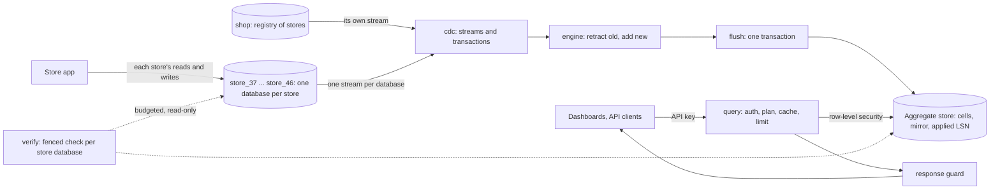

# Architecture

Each store's data sits in its own database on the main server; a platform database holds the registry of stores and companies (ADR-012). Cuboid reads every database through its own change stream, keeps exact rollups and a narrow mirror in a separate Postgres, and answers dashboard queries from there. Dashboard queries never reach the main server.

## Data flow
1. **Stream.** `internal/cdc` reads `pgoutput` from each database's slot and assembles whole transactions. Every stream hands them to one goroutine, which owns the engine, the pending delta and the flush cadence, so the write path has no locks. A store's rows are attributed to the store whose database they were read from.
2. **Contribute.** `internal/engine` turns each change into cell deltas: an insert adds, a delete retracts, an update retracts the old row and adds the new one. It is pure code, so the model test drives exactly what production runs.
3. **Flush.** Every second (or sooner for a large delta), one AGG transaction writes dictionary values, mirror rows, cell deltas, the applied position of every source database it covers, data versions and security events.
4. **Query.** `internal/planner` picks the smallest covering rollup and splits the range into whole months, days and hours, plus edge slices from the mirror.
5. **Answer.** Each read runs under row-level security in a REPEATABLE READ transaction. Rows are asserted, then the response passes the guard.

## Why the numbers are exact
- Counts and sums are integers, retractable under any change. `min`, `max` and medians are refused in config.
- Cells and mirror change in one transaction, so they always describe the same point in the stream.
- A range's whole buckets come from cells and its partial buckets from mirror rows, so any timestamp is exact.
- A join dimension (category through products) uses the current value, as a direct join would. When a product is recategorised, that store's affected rollups are recomputed from the mirror inside the same flush.

The model test (`internal/reference`) checks this against a brute-force reference, and the fenced check against each store's live database.

## Why each change applies exactly once
The applied LSN commits in the same transaction as the data, and only that committed position is reported to the main database. After a crash the stream resumes from it, and redelivered transactions at or below it are skipped. See the LSN caveat in `docs/POSTGRES_NOTES.md`.

## Keeping busy dashboards fast
- A moving preset such as `last_7d` is cached by name and reused until new data arrives or 30 seconds pass. Its answer echoes the `from` and `to` it was computed for.
- When new data arrives, a request gets the last answer, labelled `stale` with its true `as_of`, while one background refresh runs: for up to 2 seconds on a fixed range, and up to 30 seconds on a moving preset (see Moving ranges under load).
- If the store cannot answer in time, for example at the peak of a rebuild, the newest answer held is served with its true age.
- Top-N lists keyed by product or customer rank in SQL by one measure, and take the total for shares from a smaller rollup. Each verification checks this against the full result of the same snapshot.
- Top customers, whose cost grew with the store (13.7x from 1M to 10M orders), is answered through a rank rollup: each customer's total per month, indexed by value. The range splits into whole-month cells plus thin signed slices of mirror rows. A walk down each month's largest cells, summing every customer it meets, stops once no one unseen can reach the n-th total, so it reads a few hundred customers and stays exact. A filtered list, a range of more than three months, or a walk past its work budget ranks every customer as before. `meta.plan.top_bound` says which path ran. See ADR-011.

## Failure modes
| Failure | What happens |
|---|---|
| Cuboid killed | The supervisor restarts it, and every source resumes from its own committed position. 1M: 8 kills, 200 of 200 checks exact. |
| A replication connection lost | That source reconnects and resumes. An alarm names it meanwhile. |
| Main server crashes | Cuboid keeps answering with honest freshness, then reconnects. Observed at 10M: no difference after recovery. |
| Aggregate store unavailable | Cached answers are served as stale; otherwise 500 or 503. Not yet tested on purpose. |
| TRUNCATE in a store's database | That store alone reloads from a new snapshot of its database; every other store keeps streaming. |
| A check against a store's database fails | Alarm, security event, and a reload of the stores checked, at most once in ten minutes. |
| A slot falls behind | Alarm at 1 GB naming the slot; `max_slot_wal_keep_size` protects the main server's disk. Every slot shares the server's WAL, so one lagging store holds it for all. |
| A store's slot lost | Detected on reconnect; that store alone reloads. |
| A store added to or removed from the registry | Its database is loaded and streamed within seconds, or its stream stops and its rows are purged, with no restart. |
| A bulk data load | The loader sets a flag and drops the slots; Cuboid waits, then loads each store from a snapshot, four at a time. |

## Techniques the PRD names
| Technique | How Cuboid uses it |
|---|---|
| Database indexing | Cell primary key is ordered by store, rollup, grain and bucket, and rollups are written in that order so a store's range sits together on disk. Mirror index on store and time for edges. The baseline gets fair analytics indexes. |
| Pre-computing results | Rollup cells per store, grain and dimension values, chosen by the planner. |
| Caching | Per-store partitions, range-aware validity, coalesced requests, refresh in the background. |
| Background jobs or streams | Logical replication, one stream per store's database, with a one-second flush. No polling, no triggers, no nightly job. |
| Measuring performance | `cmd/bench` writes every published number to `artifacts/`, and the recorder shows the app's own query time live. |

## Scale-out path
Built: one slot and stream per store's database, each loaded, reloaded and positioned on its own, so a store is the unit that can move. Not built or tested: at 1,000+ tenants, split the stores' sources across several Cuboid processes by tenant hash, each with its own engine; put store databases on several servers (only their DSNs change); run stateless query nodes whose caches invalidate through `NOTIFY`; partition cells and mirror by tenant; or move to Kafka.

## Moving ranges under load
Every flush invalidates a moving preset such as `last_7d` on any store it touches. Recomputing each one per flush reached hundreds of queries a second with 1,000 dashboards: viewers queued at p50 410 ms, and the extra load slowed the store app on the shared machine. So a preset refreshes at most once a second, every 5 seconds while the aggregate store is at half its concurrency or more, and never makes a viewer wait while its answer is under 30 seconds old. The answer served is exact as of its stated `as_of`. Dashboards' p99 fell to about 3 ms.
