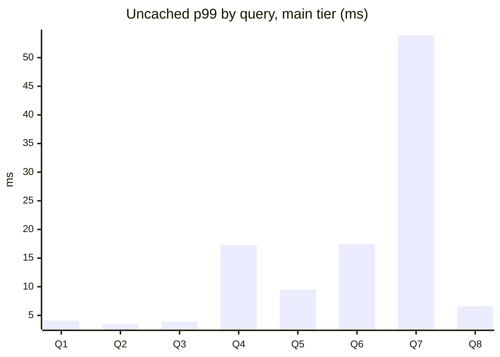

# Benchmarks

Generated by `make report` from the files in `artifacts/`. Do not edit by hand.

## Method
- **One machine.** Both databases, Cuboid, the store app and the load generator share its cores and disk. The app's own numbers therefore include contention a real deployment would not have.
- **Uncached** means the request carries the operator bench header, which skips the answer cache. It still goes through the API, planner and row security.
- **Viewers** are simulated dashboards refreshing at human pace against Cuboid, with its cache on.
- **Same data and app workload** for every path. The direct baseline has the indexes and connection pooling a careful team would give it.
- **Query speed is timed once the machine has settled after a load**, at both tiers: no autovacuum running and a load average under 4 for a minute. The store app keeps writing throughout. Straight after a 10M load, autovacuum on the new tables lifts the load average to about 32, and single answers come several times slower.
- Data is synthetic: `cmd/seed`, with one store far larger than the rest, as the PRD describes.

## Query time, main tier (T1)
Measured 1 November 2026 08:21 on 16 logical CPUs, 100 stores. 1000 viewers: p50 0 ms, p99 2 ms, 0 errors.

| Query | Uncached p50 | Uncached p99 | Largest store p99 | Cached p99 |
|---|---:|---:|---:|---:|
| FR-1 count, last 7 days | 1.6 ms | 4.1 ms | 4.0 ms | 0.6 ms |
| FR-1 summary, last 7 days | 1.5 ms | 3.5 ms | 1.8 ms | 0.6 ms |
| FR-2 trend per day, last 30 days | 1.7 ms | 3.9 ms | 2.7 ms | 0.6 ms |
| FR-3 top 10 products, this week | 3.4 ms | 17.3 ms | 27.9 ms | 0.6 ms |
| FR-4 by status, last 7 days | 1.7 ms | 9.5 ms | 3.2 ms | 0.6 ms |
| FR-4 by category, last 30 days | 2.9 ms | 17.5 ms | 6.5 ms | 0.5 ms |
| FR-3 top 10 customers, last 30 days | 8.1 ms | 53.9 ms | 46.6 ms | 0.5 ms |
| FR-1 count, arbitrary timestamps | 2.0 ms | 6.6 ms | 2.7 ms | 0.4 ms |

Q1 to Q8 follow the table's order.

## Freshness (T2)
From the store app's write to the number changing through the API. Insert p50 1025 ms, p99 1103 ms, max 1105 ms. Update p50 1050 ms, p99 1107 ms, max 1109 ms. 0 timed out.

## Database safety (T3)
The store app's own query time in each phase. Measured 1 November 2026 07:26.

| Phase | Dashboards | App p50 | App p95 | Slower at p95 | Slower at p50 | Dashboard p99 | Dashboard errors |
|---|---:|---:|---:|---:|---:|---:|---:|
| App alone (no Cuboid, no dashboards) | 0 | 0.71 ms | 2.91 ms | 0.0% | 0.0% | 0 ms | 0 |
| Cuboid running, no dashboards | 0 | 0.68 ms | 3.94 ms | 35.4% | -4.6% | 0 ms | 0 |
| Cuboid, 1000 dashboards | 1000 | 0.65 ms | 3.96 ms | 36.2% | -8.5% | 1 ms | 0 |
| Direct, 1000 dashboards | 1000 | 1.63 ms | 11.16 ms | 284.1% | 128.1% | 5036 ms | 0 |

Same data, same app workload, same machine; databases, Cuboid, the app and the load generator share the machine's cores. Compare p95: the app's p50 sits near this machine's clock tick of about 0.5 ms.

## Correctness (T4)
Random queries on random stores, each compared with direct SQL on the main database at the same WAL position. Quiesced: 2000 of 2000 exact. While writes ran: 500 of 500 exact.

## Growth, 1M to 10M orders (T5)
| Query | Pooled p99, 1M | Pooled p99, 10M | Ratio | Largest store p99, 1M | Largest store p99, 10M | Ratio |
|---|---:|---:|---:|---:|---:|---:|
| FR-1 count, last 7 days | 1.6 ms | 4.1 ms | 2.51x | 1.6 ms | 4.0 ms | 2.43x |
| FR-1 summary, last 7 days | 1.8 ms | 3.5 ms | 2.01x | 1.4 ms | 1.8 ms | 1.29x |
| FR-2 trend per day, last 30 days | 1.9 ms | 3.9 ms | 2.03x | 1.7 ms | 2.7 ms | 1.62x |
| FR-3 top 10 products, this week | 8.2 ms | 17.3 ms | 2.11x | 8.2 ms | 27.9 ms | 3.40x |
| FR-4 by status, last 7 days | 2.2 ms | 9.5 ms | 4.29x | 1.9 ms | 3.2 ms | 1.68x |
| FR-4 by category, last 30 days | 15.7 ms | 17.5 ms | 1.11x | 3.5 ms | 6.5 ms | 1.86x |
| FR-3 top 10 customers, last 30 days | 12.5 ms | 53.9 ms | 4.32x | 6.0 ms | 46.6 ms | 7.76x |
| FR-1 count, arbitrary timestamps | 1.7 ms | 6.6 ms | 3.85x | 1.7 ms | 2.7 ms | 1.58x |

Ratios of values under 10 ms are mostly noise; the absolute difference is published beside each ratio.

## Limits of these numbers
- One machine, one run of each test. Treat small differences as noise.
- Top customers ranks through month totals instead of every customer in the range (ADR-011). It is still the slowest query and the worst growth ratio, and still grows with the largest store's size.
- Isolation and chaos totals are on the Results page and in `artifacts/`, with the tier each ran at.
- `REPLICA IDENTITY FULL`'s extra WAL has not been measured.

Generated 1 November 2026 08:30.
